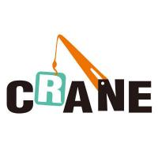

import AddonVersion from '@site/src/components/AddonVersion';
import versions from '@site/addons/catalog/crane/versions.json';

<AddonVersion data={versions} current="0.5.0" page="" />

<!-- Generated from the addon's files in kubevela/catalog. Edit them there, not here. -->

<div className="addon-logo">



</div>

:::caution Experimental
This addon is in the catalog's experimental registry: enable it with `vela addon registry add experimental --type helm --endpoint=https://kubevela.github.io/catalog/experimental/` first.
:::

Crane (FinOps Crane) is an open-source project which manages cloud resource on Kubernetes stack, it is inspired by FinOps concepts.

<dl className="addon-facts">
<dt>Addon version</dt>
<dd>

0.5.0

</dd>
<dt>Released</dt>
<dd>

2022-07-08

</dd>
<dt>KubeVela</dt>
<dd>

any

</dd>
<dt>Upstream</dt>
<dd>

[https://docs.gocrane.io/](https://docs.gocrane.io/)

</dd>
<dt>Needs</dt>
<dd>

[fluxcd](/addons/catalog/fluxcd/)

</dd>
<dt>Tags</dt>
<dd>

finops, monitoring, prediction, time-series, analytics, cost-optimization, autoscaling

</dd>
<dt>Source</dt>
<dd>

[kubevela/catalog: experimental/addons/crane](https://github.com/kubevela/catalog/tree/release/crane/0.5.0/experimental/addons/crane)

</dd>
</dl>

## Install

### With the CLI

```shell
vela addon enable crane
```


```shell
vela addon disable crane
```

### As a component (KubeVela Next)

Install it from an Application with the [`addon` component](/docs/next/end-user/components/references#addon), so the addon is declared, versioned and reviewed with the rest of your platform; deleting the Application uninstalls it. Needs the `EnableAddonComponent` feature gate (alpha, off by default): install or upgrade vela-core with `--set featureGates.enableAddonComponent=true`.

```yaml
apiVersion: core.oam.dev/v1beta1
kind: Application
metadata:
  name: platform
  namespace: vela-system
spec:
  components:
    - name: crane
      type: addon
      properties:
        registry: experimental
        version: "0.5.0"
```

## Definitions

| Definition | Type | What it does |
| --- | --- | --- |
| [`effective-hpa`](./definitions/effective-hpa) | Trait | EffectiveHorizontalPodAutoscaler supports prediction-driven autoscaling and helps you manage application scaling in an easy way. |
| [`resource-analytics`](./definitions/resource-analytics) | Trait | Resource analytics gives you recommended values for resources in a cluster and use them to improve the resource utilization of the cluster. |
## More

- [Guide](./guide): how to use the addon, from its README.
- [Versions](/addons/catalog/crane/versions): 1 release of the addon and what each needs.
## Feedback

Found something wrong, or missing something you need? Tell us in kubevela/catalog:

- [Report an issue](https://github.com/kubevela/catalog/issues/new?body=%2A%2AAddon%3A%2A%2A+crane+0.5.0%0A%0A%23%23%23+Describe+the+issue%0A%0A%3C%21--+What+happened%2C+and+what+you+expected+--%3E%0A%0A%23%23%23+Environment%0A%0A-+KubeVela+version%3A%0A-+Kubernetes+version%3A%0A&labels=type%2Fbug&title=%5Bcrane+0.5.0%5D+)
- [Request an enhancement](https://github.com/kubevela/catalog/issues/new?body=%2A%2AAddon%3A%2A%2A+crane+0.5.0%0A%0A%23%23%23+What+would+help%0A%0A%3C%21--+What+you%27d+like+the+addon+to+do%2C+and+what+it+would+let+you+do+--%3E%0A%0A%23%23%23+Environment%0A%0A-+KubeVela+version%3A%0A-+Kubernetes+version%3A%0A&labels=type%2Ffeature&title=%5Bcrane+0.5.0%5D+)
