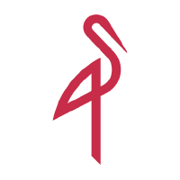

import AddonVersion from '@site/src/components/AddonVersion';
import versions from '@site/addons/catalog/minio-operator/versions.json';

<AddonVersion data={versions} current="1.0.1" page="" />

<!-- Generated from the addon's files in kubevela/catalog. Edit them there, not here. -->

<div className="addon-logo">



</div>

:::caution Experimental
This addon is in the catalog's experimental registry: enable it with `vela addon registry add experimental --type helm --endpoint=https://kubevela.github.io/catalog/experimental/` first.
:::

MinIO is a high-performance object store, API compatible with the Amazon S3 cloud storage service. This addon installs the MinIO Operator from MinIO's own Helm repository. See https://github.com/minio/operator for the operator and its licence.

<dl className="addon-facts">
<dt>Addon version</dt>
<dd>

1.0.1

</dd>
<dt>Released</dt>
<dd>

2026-11-27

</dd>
<dt>KubeVela</dt>
<dd>

any

</dd>
<dt>Upstream</dt>
<dd>

[https://min.io/](https://min.io/)

</dd>
<dt>Needs</dt>
<dd>

[fluxcd](/addons/catalog/fluxcd/)

</dd>
<dt>Tags</dt>
<dd>

minio-operator

</dd>
<dt>Source</dt>
<dd>

[kubevela/catalog: experimental/addons/minio-operator](https://github.com/kubevela/catalog/tree/release/minio-operator/1.0.1/experimental/addons/minio-operator)

</dd>
</dl>

## Install

### With the CLI

```shell
vela addon enable minio-operator
```

Set [parameters](./parameters) as `key=value` on the same command.

```shell
vela addon disable minio-operator
```

### As a component (KubeVela Next)

Install it from an Application with the [`addon` component](/docs/next/end-user/components/references#addon), so the addon is declared, versioned and reviewed with the rest of your platform; deleting the Application uninstalls it. Needs the `EnableAddonComponent` feature gate (alpha, off by default): install or upgrade vela-core with `--set featureGates.enableAddonComponent=true`.

```yaml
apiVersion: core.oam.dev/v1beta1
kind: Application
metadata:
  name: platform
  namespace: vela-system
spec:
  components:
    - name: minio-operator
      type: addon
      properties:
        registry: experimental
        version: "1.0.1"
        properties:
          namespace: "minio-operator"
```

## More

- [Parameters](./parameters): everything `vela addon enable` takes.
- [Guide](./guide): how to use the addon, from its README.
- [Versions](/addons/catalog/minio-operator/versions): 2 releases of the addon and what each needs.
## Feedback

Found something wrong, or missing something you need? Tell us in kubevela/catalog:

- [Report an issue](https://github.com/kubevela/catalog/issues/new?body=%2A%2AAddon%3A%2A%2A+minio-operator+1.0.1%0A%0A%23%23%23+Describe+the+issue%0A%0A%3C%21--+What+happened%2C+and+what+you+expected+--%3E%0A%0A%23%23%23+Environment%0A%0A-+KubeVela+version%3A%0A-+Kubernetes+version%3A%0A&labels=type%2Fbug&title=%5Bminio-operator+1.0.1%5D+)
- [Request an enhancement](https://github.com/kubevela/catalog/issues/new?body=%2A%2AAddon%3A%2A%2A+minio-operator+1.0.1%0A%0A%23%23%23+What+would+help%0A%0A%3C%21--+What+you%27d+like+the+addon+to+do%2C+and+what+it+would+let+you+do+--%3E%0A%0A%23%23%23+Environment%0A%0A-+KubeVela+version%3A%0A-+Kubernetes+version%3A%0A&labels=type%2Ffeature&title=%5Bminio-operator+1.0.1%5D+)
